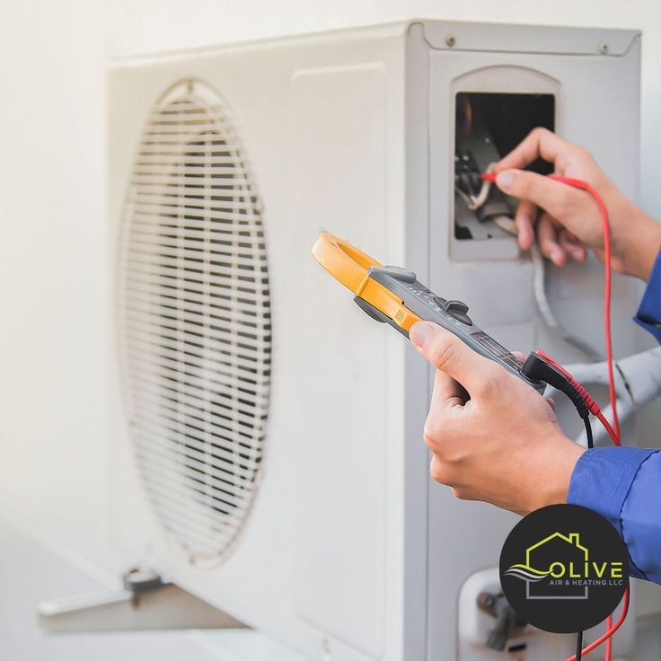

## Giới thiệu về dịch vụ sửa chữa máy lạnh tại Thủ Đức
Dịch vụ sửa chữa máy lạnh tại Thủ Đức của AirCool Pro được thiết kế để đáp ứng nhu cầu của cư dân địa phương. Với đội ngũ kỹ thuật viên giàu kinh nghiệm, chúng tôi cam kết mang đến dịch vụ sửa chữa nhanh chóng và hiệu quả nhất.

## Những dấu hiệu cần sửa chữa máy lạnh
Khi máy lạnh của bạn gặp sự cố, có thể nhận biết qua một số dấu hiệu như:
- Máy không lạnh hoặc lạnh yếu.
- Xuất hiện tiếng kêu lạ khi hoạt động.
- Máy phát ra mùi hôi hoặc mùi lạ.
- Nước chảy ra từ máy lạnh.

### Nguyên nhân và cách khắc phục
1. **Máy không lạnh hoặc lạnh yếu**: Có thể do thiếu gas hoặc bộ lọc bị bẩn. Giải pháp: Kiểm tra và nạp gas hoặc vệ sinh bộ lọc.
2. **Tiếng kêu lạ**: Có thể do quạt bị kẹt hoặc linh kiện bị hỏng. Giải pháp: Kiểm tra và thay thế linh kiện hỏng.
3. **Mùi hôi**: Thường do nấm mốc trong dàn lạnh. Giải pháp: Vệ sinh dàn lạnh định kỳ.
4. **Nước chảy ra**: Do tắc ống thoát nước. Giải pháp: Thông tắc ống thoát nước.

## Bảng giá dịch vụ sửa chữa máy lạnh
| Dịch vụ                          | Giá (VNĐ)       | Ưu đãi                                         |
|----------------------------------|------------------|------------------------------------------------|
| Sửa chữa máy lạnh Treo Tường     | 150.000₫ / lần    | Giảm 10% tổng hóa đơn khi làm từ 3 máy trở lên |
| Sửa chữa máy lạnh Âm Trần       | 150.000₫ / lần    | Giảm 10% tổng hóa đơn khi làm từ 3 máy trở lên |
| Sửa chữa máy lạnh Tủ Đứng       | 400.000₫ / lần    | Giảm 10% tổng hóa đơn khi làm từ 3 máy trở lên |

### Quy trình sửa chữa máy lạnh tại AirCool Pro
1. **Tiếp nhận yêu cầu**: Khách hàng liên hệ qua hotline hoặc Zalo.
2. **Khảo sát tình trạng máy**: Kỹ thuật viên đến tận nơi kiểm tra máy lạnh.
3. **Báo giá dịch vụ**: Sau khi kiểm tra, chúng tôi sẽ báo giá chi tiết cho khách hàng.
4. **Tiến hành sửa chữa**: Nếu khách hàng đồng ý, chúng tôi sẽ tiến hành sửa chữa ngay lập tức.
5. **Kiểm tra lại máy**: Sau khi sửa chữa, chúng tôi sẽ kiểm tra lại toàn bộ hệ thống.

## Tại sao chọn AirCool Pro?
- **Đội ngũ kỹ thuật viên chuyên nghiệp**: Chúng tôi có đội ngũ kỹ thuật viên được đào tạo bài bản và có nhiều năm kinh nghiệm trong ngành.
- **Thời gian phục vụ linh hoạt**: Chúng tôi phục vụ 24/7, có mặt sau 30 phút kể từ khi nhận yêu cầu.
- **Giá cả hợp lý**: Chúng tôi cam kết cung cấp dịch vụ chất lượng với giá cả cạnh tranh.

## Liên hệ với chúng tôi
Nếu bạn đang tìm kiếm dịch vụ sửa chữa máy lạnh tại Thủ Đức, hãy liên hệ với AirCool Pro ngay hôm nay qua hotline: 0968.831.027 hoặc đặt lịch dịch vụ [tại đây](/?utm_source=blog&utm_medium=contextual_link&utm_campaign=dich-vu-sua-chua-may-lanh-tai-thu-duc#services). Chúng tôi luôn sẵn sàng phục vụ bạn!

Ngoài ra, bạn có thể tham khảo thêm [bảng tính chi phí dịch vụ tự động](/?utm_source=blog&utm_medium=contextual_link&utm_campaign=dich-vu-sua-chua-may-lanh-tai-thu-duc#calculator) để có cái nhìn tổng quan hơn về giá cả dịch vụ.
