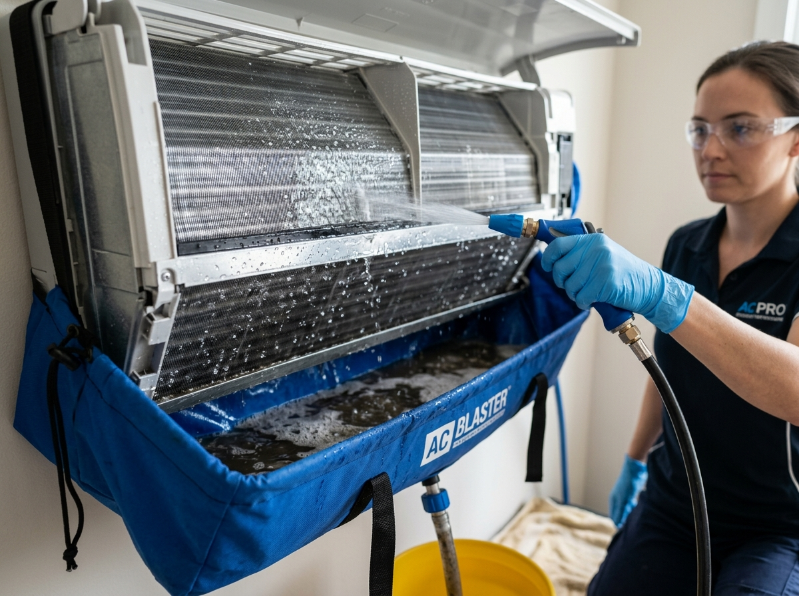

## Tại Sao Cần Vệ Sinh Điều Hòa Định Kỳ?
Vệ sinh điều hòa là một trong những công việc quan trọng giúp máy lạnh hoạt động hiệu quả và bền bỉ hơn. Khi máy lạnh bám bụi bẩn, hiệu suất làm lạnh sẽ giảm, dẫn đến việc tiêu tốn điện năng nhiều hơn. Điều này không chỉ ảnh hưởng đến hóa đơn điện của bạn mà còn có thể gây ra hư hỏng cho máy.

## Quy Trình Vệ Sinh Điều Hòa Tại AirCool Pro
Chúng tôi cam kết cung cấp dịch vụ vệ sinh điều hòa chuyên nghiệp với quy trình rõ ràng:
1. **Kiểm tra tổng quát**: Đánh giá tình trạng máy lạnh trước khi thực hiện vệ sinh.
2. **Vệ sinh dàn lạnh**: Xịt rửa dàn lạnh, lồng sóc quạt và lưới lọc.
3. **Vệ sinh dàn nóng**: Làm sạch dàn nóng bên ngoài và thông tắc đường ống thoát nước thải.
4. **Đo kiểm**: Đo kiểm dòng điện và áp suất gas miễn phí để đảm bảo máy chạy ổn định.

## Bảng Giá Dịch Vụ Vệ Sinh Điều Hòa
Dưới đây là bảng giá dịch vụ vệ sinh điều hòa mà AirCool Pro cung cấp:

| Dịch Vụ                        | Giá (VNĐ)     | Ưu Đãi                                  |
|--------------------------------|---------------|-----------------------------------------|
| Vệ Sinh Máy Lạnh Treo Tường    | 250.000       | Giảm 10% khi làm từ 3 máy trở lên      |
| Vệ Sinh Máy Lạnh Tủ Đứng       | 650.000       | Giảm 10% khi làm từ 3 máy trở lên      |
| Vệ Sinh Máy Lạnh Âm Trần      | 850.000       | Giảm 10% khi làm từ 3 máy trở lên      |

## Lợi Ích Của Dịch Vụ Vệ Sinh Điều Hòa
- **Tiết kiệm điện năng**: Máy lạnh sạch sẽ giúp giảm tiêu thụ điện.
- **Kéo dài tuổi thọ máy**: Vệ sinh định kỳ giúp máy hoạt động ổn định và bền bỉ hơn.
- **Không khí trong lành**: Giảm thiểu bụi bẩn và nấm mốc trong không khí.

## Cách Đặt Lịch Vệ Sinh Điều Hòa Tại AirCool Pro
Để đặt lịch dịch vụ vệ sinh điều hòa, bạn chỉ cần gọi đến Hotline/Zalo: **0968.831.027**. Chúng tôi phục vụ từ 7:30 đến 21:00 cả Thứ 7, Chủ Nhật và Lễ. Đội ngũ kỹ thuật viên của chúng tôi sẽ có mặt trong vòng 30 phút sau khi nhận được yêu cầu của bạn.

## Kết Luận
Dịch vụ vệ sinh điều hòa không chỉ giúp máy lạnh của bạn hoạt động hiệu quả hơn mà còn tiết kiệm chi phí trong dài hạn. Hãy liên hệ với chúng tôi để trải nghiệm dịch vụ tốt nhất!

Ngoài ra, bạn có thể tham khảo thêm thông tin về [bảng tính chi phí dịch vụ tự động](/?utm_source=blog&utm_medium=contextual_link&utm_campaign=dich-vu-ve-sinh-dieu-hoa-tai-thu-duc#calculator) hoặc [đặt lịch dịch vụ vệ sinh & sửa máy lạnh AirCool Pro](/?utm_source=blog&utm_medium=contextual_link&utm_campaign=dich-vu-ve-sinh-dieu-hoa-tai-thu-duc#services).
