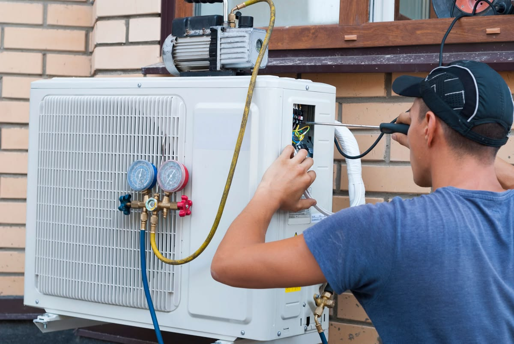

Rất nhiều khách hàng tại Thủ Đức khi gọi thợ vệ sinh máy lạnh thường nhận được câu nói quen thuộc: *"Chị ơi máy hết sạch gas rồi, phải nạp thêm gas mới mát được, phí thêm 300k - 500k nhé"*. Nhưng sự thật kỹ thuật là gì? Máy lạnh có thực sự tự hết gas sau mỗi năm sử dụng hay không? Hãy cùng các kỹ thuật viên dày dặn kinh nghiệm của **AirCool Pro** làm rõ ngay dưới đây.

## 1. Sự thật: Gas máy lạnh có tự tiêu hao theo thời gian không?

Câu trả lời từ các kỹ sư nhiệt lạnh là: **KHÔNG**. Hệ thống làm lạnh của máy điều hòa là một **chu trình khép kín tuần hoàn 100%**. Khí gas (môi chất làm lạnh) chỉ chuyển hóa qua lại giữa thể khí và thể lỏng để hấp thụ và thải nhiệt ra ngoài môi trường.

Nếu hệ thống ống đồng được lắp đặt chuẩn chỉ, máy lạnh có thể hoạt động **5 năm, 10 năm hoặc thậm chí trọn đời máy mà không hề mất đi một gram gas nào**. Máy lạnh chỉ bị hao hụt gas khi và chỉ khi **xảy ra rò rỉ (xì gas)** ở các vị trí như:

- Xì ở các mối nối zắc-co, đầu tán ống đồng do thợ lắp xiết chưa đủ lực hoặc bị nứt.
- Mục ống đồng, thủng giàn lạnh hoặc giàn nóng do môi trường axit, gần cống rãnh hoặc ăn mòn tự nhiên.
- Xì ti sạc gas (van nạp) ở dàn nóng ngoài trời.

## 2. 4 Dấu hiệu nhận biết máy lạnh thực sự đang bị thiếu gas

Nếu máy lạnh nhà bạn gặp sự cố xì gas, bạn sẽ dễ dàng nhận thấy các hiện tượng kỹ thuật đặc trưng sau:

### Dấu hiệu 1: Bật máy chạy rất lâu nhưng không thấy lạnh sâu

Quạt gió dàn lạnh vẫn quay bình thường, máy vẫn chạy nhưng gió phà ra chỉ hơi thoang thoảng hoặc mát như quạt gió thông thường dù bạn đã hạ remote xuống tận 16°C – 18°C.

### Dấu hiệu 2: Đóng tuyết trắng ở ống đồng hoặc dàn lạnh

Khi thiếu gas, áp suất sôi của môi chất lạnh giảm xuống khiến nhiệt độ bay hơi thấp hơn bình thường, dẫn đến việc ngưng tụ và đóng tuyết đóng băng ở đầu ống đồng nhỏ tại dàn nóng hoặc đóng tảng tuyết trên lá nhôm dàn lạnh.

### Dấu hiệu 3: Máy báo lỗi chớp đèn Timer liên tục

Ở các dòng máy lạnh Inverter hiện đại (Daikin, Panasonic, Toshiba, Mitsubishi...), bo mạch được trang bị cảm biến nhiệt độ đầu đẩy máy nén. Khi thiếu gas, nhiệt độ máy nén tăng cao bất thường, máy sẽ tự ngắt bảo vệ sau 15–30 phút chạy và chớp đèn Timer nhấp nháy báo lỗi.

### Dấu hiệu 4: Dòng điện hoạt động (Ampe) tụt giảm

Khi kỹ thuật viên kẹp đồng hồ Ampe kìm vào dây nguồn máy nén, dòng điện tiêu thụ thực tế sẽ thấp hơn rõ rệt so với thông số danh định in trên tem máy.

  <h4 style="margin-top:0; color:#b91c1c;">CẢNH GIÁC: Chiêu trò "Vẽ Bệnh Nạp Gas" Của Thợ Kém Uy Tín</h4>
  
Nhiều nơi quảng cáo "Vệ sinh máy lạnh chỉ 50k - 80k", sau đó khi đến nhà khách sẽ lấy đồng hồ giả vờ đo hoặc thậm chí cố tình xả van rồi báo máy hết sạch gas để tính thêm tiền nạp gas tiền trăm, tiền triệu. Hãy luôn yêu cầu thợ <strong>đo áp suất PSI bằng đồng hồ trước mặt bạn</strong> trước khi quyết định nạp!

## 3. Quy trình nạp gas chuẩn kỹ thuật tại AirCool Pro

Tại **AirCool Pro**, chúng tôi tuân thủ đạo đức nghề nghiệp và quy chuẩn kỹ thuật nghiêm ngặt:

1. **Kiểm tra nguyên nhân trước:** Nếu thực sự thiếu gas, thợ phải tìm và hàn xử lý triệt để vị trí xì ống đồng trước khi nạp gas mới (nếu chỉ bơm gas mà không sửa chỗ xì thì vài ngày sau gas lại bay hết sạch).
2. **Hút chân không đường ống:** Đối với các loại gas mới như **R32** và **R410A**, bắt buộc phải dùng máy hút chân không loại bỏ hết không khí và hơi ẩm trước khi nạp.
3. **Đo đúng áp suất và cân định lượng:** Nạp vừa đủ theo khuyến cáo nhà sản xuất (ví dụ: Gas R32/R410A áp suất hút chuẩn khoảng 120 – 140 PSI, Gas R22 từ 65 – 75 PSI). Nạp thừa gas cũng gây quá tải hỏng block máy nén!

  <h4 style="margin-top:0; color:#0f766e;">Cam Kết Minh Bạch Tại AirCool Pro:</h4>
  
Thợ chỉ nạp gas khi có sự đồng ý của khách hàng sau khi kiểm tra đồng hồ. Báo giá công khai trọn gói, tuyệt đối không vẽ vời, bảo hành đường hàn và nạp gas từ 6 - 12 tháng. Bạn có thể tra cứu chi phí công khai tại <a href="/?utm_source=blog&utm_medium=contextual_link&utm_campaign=bom_gas#services" style="color:#0f766e; font-weight:700; text-decoration:underline;">Dịch vụ nạp gas & sửa máy lạnh chuẩn hãng</a> hoặc tham khảo <a href="/?utm_source=blog&utm_medium=contextual_link&utm_campaign=bom_gas#calculator" style="color:#0f766e; font-weight:700; text-decoration:underline;">bảng dự toán chi phí dịch vụ</a> tại trang chủ của chúng tôi.

