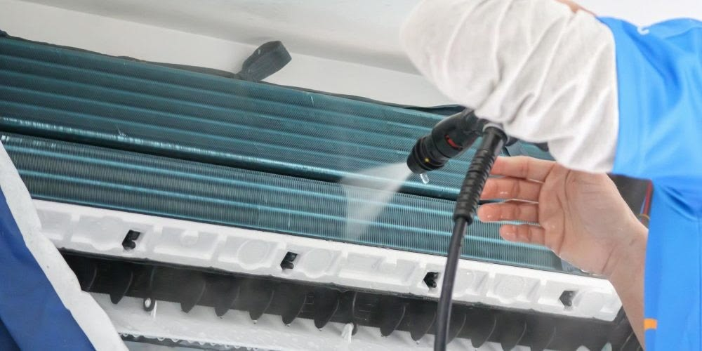

Vào những đợt nắng nóng đỉnh điểm ở TP.HCM và khu vực Thủ Đức, chiếc máy lạnh gần như phải hoạt động suốt 24/7. Hậu quả đi kèm là hóa đơn tiền điện cuối tháng có thể tăng vọt lên gấp đôi, gấp ba khiến nhiều gia đình "đứng ngồi không yên". Tuy nhiên, nếu bạn biết áp dụng đúng **7 nguyên tắc kỹ thuật** dưới đây, bạn hoàn toàn có thể tận hưởng không gian mát rượi cả ngày lẫn đêm mà tiền điện chỉ tăng rất nhẹ!

## 1. Cài đặt "nhiệt độ vàng" từ 26°C – 28°C

Nhiều người có thói quen vừa vào phòng là bấm ngay mức nhiệt độ thấp nhất 16°C – 18°C. Điều này khiến máy nén (block) phải gồng hết công suất tối đa trong thời gian dài, tiêu tốn lượng điện khổng lồ.

Theo nghiên cứu của Bộ Công Thương và các chuyên gia điều hòa, **mỗi khi bạn hạ nhiệt độ xuống 1°C dưới 25°C, máy lạnh sẽ tiêu thụ thêm từ 7% đến 10% lượng điện**. Mức nhiệt độ lý tưởng nhất cho khí hậu Việt Nam là **26°C – 28°C**: vừa đủ mát dịu, bảo vệ hô hấp cho cả gia đình, vừa giúp máy nén Inverter chạy ở dải công suất tiết kiệm điện nhất.

## 2. Luôn bật kèm quạt gió thoang thoảng

Đây là bí quyết đơn giản nhưng hiệu quả nhất: Hãy bật kèm một chiếc quạt cây hoặc quạt trần ở mức gió nhẹ. Quạt sẽ giúp không khí lạnh từ điều hòa luân chuyển đều khắp phòng thay vì chỉ tụ lại ở một góc dưới sàn. Nhờ luồng gió đối lưu, cơ thể bạn sẽ có cảm giác mát hơn từ 1°C – 2°C so với nhiệt độ thực tế, cho phép bạn tự tin cài đặt máy lạnh ở mức 27°C hoặc 28°C.

## 3. Đóng kín cửa và kéo rèm cản nhiệt

Ánh nắng mặt trời chiếu trực tiếp qua cửa kính có thể làm tăng nhiệt độ phòng lên từ 3°C – 5°C. Hãy kéo rèm che nắng ban ngày để giảm bức xạ nhiệt. Đồng thời, kiểm tra các khe hở ở cửa sổ, chân cửa ra vào để tránh khí lạnh thất thoát ra ngoài khiến máy lạnh phải bù nhiệt liên tục.

## 4. Tuyệt đối không bật / tắt máy lạnh liên tục

Nhiều người nghĩ rằng: *"Bật máy thật lạnh rồi tắt đi, khi nào nóng lại bật lại"* sẽ tiết kiệm điện. Thực tế hoàn toàn ngược lại!

Mỗi lần khởi động lại từ đầu, động cơ máy nén phải tốn một dòng điện khởi động (khởi động mềm hoặc đề pha) cực kỳ lớn để kéo nhiệt độ phòng từ nóng về lạnh. Đối với dòng máy Inverter, khi đạt đủ nhiệt độ, máy sẽ tự động giảm tần số quay xuống mức tối thiểu (chỉ ăn khoảng 200W – 300W/giờ). Do đó, để máy chạy ổn định liên tục sẽ tiết kiệm hơn rất nhiều so với việc bật tắt ngắt quãng.

## 5. Tận dụng chế độ ngủ đêm (Sleep Mode) hoặc Eco Mode

Vào ban đêm, nhiệt độ ngoài trời giảm dần và thân nhiệt người ngủ cũng hạ thấp. Nếu bạn để nguyên mức 24°C suốt đêm, bạn sẽ dễ bị thức giấc vì lạnh buốt và nghẹt mũi.

Chế độ **Sleep Mode** trên remote sẽ tự động tăng thêm 1°C sau 1 tiếng và thêm 1°C nữa sau 2 tiếng. Tính năng này vừa giúp bạn có giấc ngủ sâu trọn vẹn, không lo cảm lạnh, vừa tiết kiệm thêm từ 15% – 20% điện năng tiêu thụ trong suốt đêm dài.

## 6. Vệ sinh lưới lọc bụi 2 tuần/lần và bảo dưỡng định kỳ

Lớp bụi dày bám trên lưới lọc và dàn tản nhiệt là "kẻ trộm điện" thầm lặng số một. Khi bị bụi bít kín, quạt phải quay mạnh hơn nhưng gió thổi ra vẫn yếu, máy nén phải chạy liên tục không ngắt. Định kỳ vệ sinh lưới lọc chỉ mất 5 phút tại nhà, và gọi <a href="/?utm_source=blog&utm_medium=contextual_link&utm_campaign=tiet_kiem_dien#services" style="color:#0891b2; font-weight:700; text-decoration:underline;">dịch vụ vệ sinh máy lạnh chuyên nghiệp tại Thủ Đức</a> sau mỗi 3 – 4 tháng sẽ giúp giảm ngay 15% – 25% hóa đơn tiền điện.

  <h4 style="margin-top:0; color:#0f766e;">Mẹo Nhỏ Cho Phòng Có Trẻ Nhỏ & Người Cao Tuổi:</h4>
  
Nên đặt một chậu nước nhỏ hoặc máy tạo ẩm trong phòng máy lạnh để giữ độ ẩm không khí từ 50% - 60%, giúp bảo vệ da không bị khô và tránh viêm họng.

## 7. Hẹn giờ tắt máy lạnh trước khi thức dậy 30 phút

Trước khi dậy đi làm khoảng 30 – 45 phút, độ lạnh trong phòng kín vẫn được giữ lại rất tốt. Bạn hãy cài đặt tính năng Timer Off để máy tự ngắt sớm. Khoảng thời gian này vừa đủ để phòng mát mẻ, cơ thể thích nghi dần với nhiệt độ môi trường bên ngoài mà lại tiết kiệm được một lượng điện đáng kể mỗi ngày.
