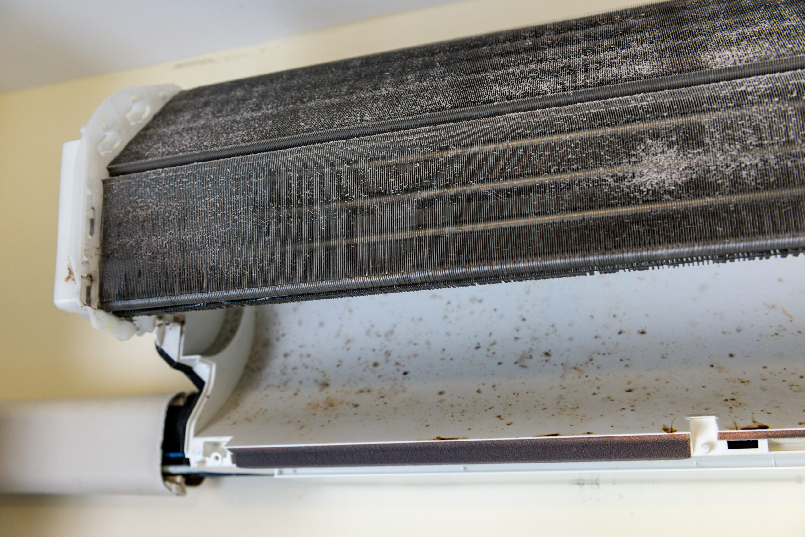

Nhiều gia đình ở Thủ Đức thường đợi đến khi máy lạnh hư hẳn mới gọi thợ. Thói quen này không chỉ khiến bạn phải tốn hàng triệu đồng tiền sửa chữa, mà còn làm giảm tuổi thọ của máy nghiêm trọng. Dưới đây là 5 dấu hiệu "báo động đỏ" nhắc bạn cần gọi <a href="/?utm_source=blog&utm_medium=contextual_link&utm_campaign=meo_sua#services" style="color:#0891b2; font-weight:700; text-decoration:underline;">dịch vụ vệ sinh máy lạnh tại nhà</a> ngay lập tức.

## 1. Máy lạnh thổi ra luồng gió có mùi hôi, nấm mốc

Nếu bạn vừa bật máy lạnh lên và ngửi thấy mùi hôi khó chịu, mùi ẩm mốc... thì 100% dàn lạnh của bạn đang chứa một ổ vi khuẩn. Sự tích tụ của bụi bẩn kết hợp với môi trường ẩm ướt trong dàn lạnh là điều kiện lý tưởng để nấm mốc phát triển. Hít phải luồng khí này lâu ngày cực kỳ có hại cho đường hô hấp của trẻ nhỏ.

## 2. Bật mãi nhưng không thấy mát

Bạn đã chỉnh nhiệt độ xuống 18 độ C, quạt chạy vù vù nhưng phòng vẫn nóng nực? Nguyên nhân lớn nhất là do lớp bụi dày đặc bít kín lưới lọc và dàn lá nhôm, khiến khí lạnh không thể thổi ra ngoài được. Vệ sinh máy lạnh sẽ giải quyết triệt để tình trạng này.

## 3. Máy lạnh bị chảy nước ở cục lạnh trong nhà

Khi bụi bẩn bám quá nhiều vào máng hứng nước và đường ống thoát nước, nước ngưng tụ sẽ không thể chảy ra ngoài mà tràn ngược vào trong nhà. Tình trạng này nếu để lâu có thể gây chập cháy bo mạch điện tử bên trong máy.

  <h4 style="margin-top:0; color:#0f766e;">Lời Khuyên Từ Chuyên Gia AirCool Pro:</h4>
  
Đừng cố tự tháo lắp nếu bạn không có chuyên môn và dụng cụ. Việc tự vệ sinh sai cách (như xịt nước vào bo mạch) có thể khiến máy hư hỏng hoàn toàn. Hãy tham khảo <a href="/?utm_source=blog&utm_medium=contextual_link&utm_campaign=meo_sua#calculator" style="color:#0f766e; font-weight:700; text-decoration:underline;">bảng tính chi phí bảo dưỡng trọn gói</a> để đặt thợ chuyên nghiệp!

## 4. Dàn nóng (cục ngoài trời) kêu to bất thường

Dàn nóng đặt ngoài ban công hoặc trên mái nhà phải chịu nắng mưa và bụi bẩn rất lớn. Khi cánh quạt tản nhiệt hoặc block bị kẹt bụi, nó sẽ phát ra tiếng rít lớn và có nguy cơ chết block nếu không được vệ sinh kịp thời.

## 5. Hóa đơn tiền điện tăng vọt

Nếu tiền điện tháng này của bạn tăng gấp đôi, gấp ba dù thời gian sử dụng máy không đổi, thì thủ phạm chính là chiếc máy lạnh bị bẩn. Máy bẩn phải làm việc liên tục (không thể tự ngắt) để đạt được nhiệt độ yêu cầu, gây ngốn điện khủng khiếp.
