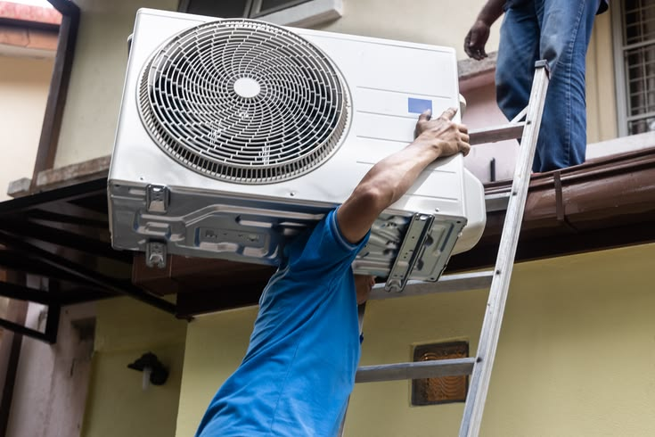

## Giới thiệu về dịch vụ tháo lắp di dời máy lạnh chung cư tại Thủ Đức
Khi bạn quyết định chuyển nhà hoặc di dời máy lạnh trong chung cư, việc tháo lắp máy lạnh đúng cách là vô cùng quan trọng. Không chỉ giúp máy lạnh hoạt động hiệu quả, mà còn tránh tình trạng hao gas và hư hỏng thiết bị. 

## Tại sao nên chọn dịch vụ tháo lắp di dời máy lạnh chuyên nghiệp?
- **Tiết kiệm thời gian:** Kỹ thuật viên có kinh nghiệm sẽ thực hiện công việc nhanh chóng, giúp bạn tiết kiệm thời gian và công sức.
- **Đảm bảo an toàn:** Việc tháo lắp máy lạnh không đúng cách có thể gây ra rò rỉ gas hoặc hư hỏng thiết bị. Dịch vụ chuyên nghiệp sẽ đảm bảo an toàn cho bạn và thiết bị.
- **Tiết kiệm chi phí:** Nếu bạn tự tháo lắp mà gây hư hỏng, chi phí sửa chữa sẽ cao hơn nhiều so với việc sử dụng dịch vụ chuyên nghiệp ngay từ đầu.

## Quy trình tháo lắp di dời máy lạnh tại AirCool Pro
1. **Khảo sát và tư vấn:** Kỹ thuật viên sẽ đến tận nơi khảo sát và tư vấn giải pháp tốt nhất cho bạn.
2. **Chuẩn bị dụng cụ:** Các dụng cụ cần thiết sẽ được chuẩn bị đầy đủ để đảm bảo quá trình tháo lắp diễn ra suôn sẻ.
3. **Tháo lắp máy lạnh:** Kỹ thuật viên sẽ thực hiện tháo lắp máy lạnh theo đúng quy trình kỹ thuật, đảm bảo không làm hư hỏng thiết bị.
4. **Kiểm tra và bảo trì:** Sau khi lắp đặt, kỹ thuật viên sẽ kiểm tra và bảo trì máy lạnh để đảm bảo hoạt động ổn định.

## Bảng giá dịch vụ tháo lắp di dời máy lạnh
| Dịch vụ | Giá (VNĐ) | Ưu đãi | Bảo hành |
| --- | --- | --- | --- |
| Tháo lắp & di dời máy lạnh Treo Tường (1 - 2.5 HP) | 700.000₫ / máy | Giảm 10% khi làm từ 3 máy trở lên | Bảo hành lắp đặt 6 - 12 tháng |
| Tháo lắp & di dời máy lạnh Tủ Đứng | 850.000₫ / máy | Giảm 10% khi làm từ 3 máy trở lên | Bảo hành lắp đặt 6 - 12 tháng |
| Tháo lắp & di dời máy lạnh Âm Trần / Cassette | 2.250.000₫ / máy | Giảm 10% khi làm từ 3 máy trở lên | Bảo hành lắp đặt 6 - 12 tháng |

## Những lưu ý khi tháo lắp di dời máy lạnh
- **Kiểm tra tình trạng máy lạnh trước khi tháo lắp:** Đảm bảo rằng máy lạnh vẫn hoạt động tốt để tránh hư hỏng trong quá trình di dời.
- **Lựa chọn đơn vị uy tín:** Chọn dịch vụ tháo lắp máy lạnh có uy tín để đảm bảo chất lượng dịch vụ.
- **Bảo trì định kỳ:** Sau khi di dời, cần thực hiện bảo trì định kỳ để máy lạnh hoạt động hiệu quả.

## Kết luận
Việc tháo lắp di dời máy lạnh là một công việc không hề đơn giản. Để đảm bảo an toàn và tiết kiệm chi phí, hãy lựa chọn dịch vụ chuyên nghiệp từ AirCool Pro. Chúng tôi cam kết mang đến cho bạn dịch vụ tốt nhất với giá cả hợp lý.

Để biết thêm thông tin chi tiết, hãy liên hệ với chúng tôi qua [bảng tính chi phí dịch vụ tự động](/?utm_source=blog&utm_medium=contextual_link&utm_campaign=thao-lap-di-doi-may-lanh-chung-cu-thu-duc-tron-goi#calculator) hoặc [đặt lịch dịch vụ vệ sinh & sửa máy lạnh AirCool Pro](/?utm_source=blog&utm_medium=contextual_link&utm_campaign=thao-lap-di-doi-may-lanh-chung-cu-thu-duc-tron-goi#services).
