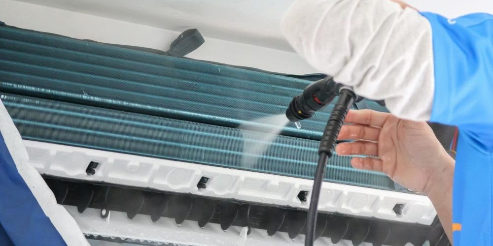

## Tại Sao Cần Vệ Sinh Máy Lạnh Âm Trần Cassette?
Vệ sinh máy lạnh âm trần cassette không chỉ giúp cải thiện hiệu suất làm mát mà còn bảo vệ sức khỏe của người sử dụng. Bụi bẩn và vi khuẩn tích tụ trong máy lạnh có thể gây ra các vấn đề về hô hấp và dị ứng. Đặc biệt trong môi trường văn phòng, nơi có nhiều người làm việc, việc duy trì không khí trong lành là cực kỳ quan trọng.

## Quy Trình Vệ Sinh Máy Lạnh Âm Trần Cassette
Quy trình vệ sinh máy lạnh âm trần cassette bao gồm các bước sau:

1. **Kiểm Tra Trước Khi Vệ Sinh**: Kỹ thuật viên sẽ kiểm tra tình trạng máy lạnh, xác định các vấn đề cần khắc phục.
2. **Tháo Mặt Nạ Dàn Lạnh**: Tháo mặt nạ để tiếp cận các bộ phận bên trong máy.
3. **Vệ Sinh Dàn Lạnh**: Sử dụng máy áp lực để xịt rửa dàn lạnh, lưới lọc và máng nước ngưng.
4. **Vệ Sinh Dàn Nóng**: Vệ sinh bên ngoài dàn nóng để đảm bảo máy hoạt động hiệu quả.
5. **Kiểm Tra Lại**: Đo kiểm dòng điện, áp suất gas và kiểm tra toàn bộ máy trước khi lắp lại.

## Bảng Giá Dịch Vụ Vệ Sinh Máy Lạnh
| Dịch Vụ                                       | Giá                | Ưu Đãi                                          |
|-----------------------------------------------|--------------------|------------------------------------------------|
| Vệ Sinh Máy Lạnh Âm Trần / Cassette          | 850.000₫ / máy     | Giảm 10% tổng hóa đơn khi làm từ 3 máy trở lên |

## Lợi Ích Của Việc Vệ Sinh Định Kỳ
- **Tiết Kiệm Chi Phí**: Giúp giảm chi phí điện năng do máy hoạt động hiệu quả hơn.
- **Kéo Dài Tuổi Thọ Máy**: Bảo trì định kỳ giúp máy lạnh hoạt động lâu dài hơn.
- **Cải Thiện Không Khí**: Đảm bảo không khí trong lành, giảm nguy cơ mắc bệnh.

## Lời Khuyên Khi Sử Dụng Máy Lạnh
- Nên vệ sinh máy lạnh ít nhất 6 tháng một lần.
- Sử dụng dịch vụ vệ sinh chuyên nghiệp để đảm bảo chất lượng.

## Liên Hệ Đặt Dịch Vụ
Nếu bạn cần dịch vụ vệ sinh máy lạnh âm trần cassette tại Thủ Đức, hãy liên hệ với chúng tôi qua Hotline/Zalo: 0968.831.027. Chúng tôi phục vụ 7:30 - 21:00 cả Thứ 7, Chủ Nhật và Lễ.

Ngoài ra, bạn có thể tham khảo thêm [bảng tính chi phí dịch vụ tự động](/?utm_source=blog&utm_medium=contextual_link&utm_campaign=ve-sinh-may-lanh-am-tran-cassette-van-phong-thu-duc#calculator) hoặc [đặt lịch dịch vụ vệ sinh & sửa máy lạnh AirCool Pro](/?utm_source=blog&utm_medium=contextual_link&utm_campaign=ve-sinh-may-lanh-am-tran-cassette-van-phong-thu-duc#services).
